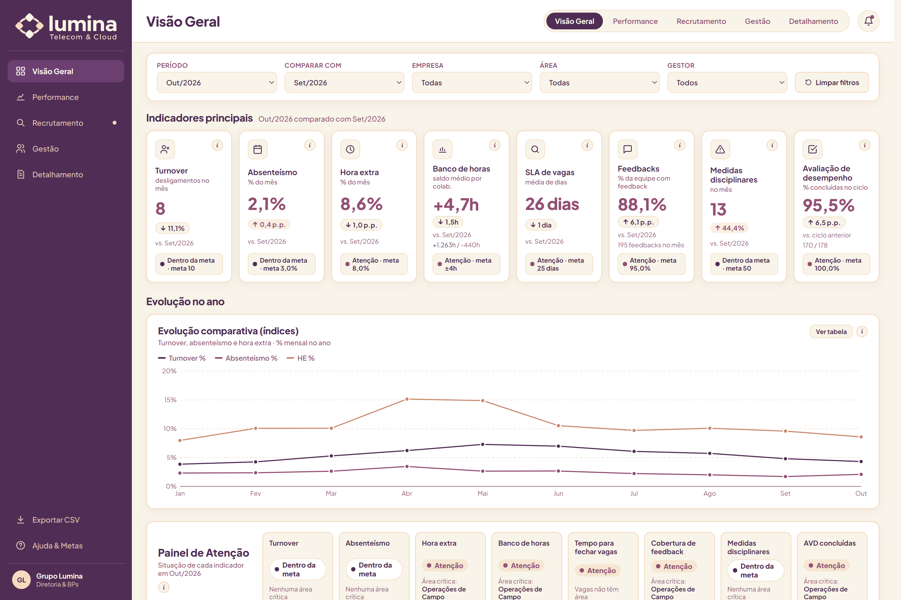
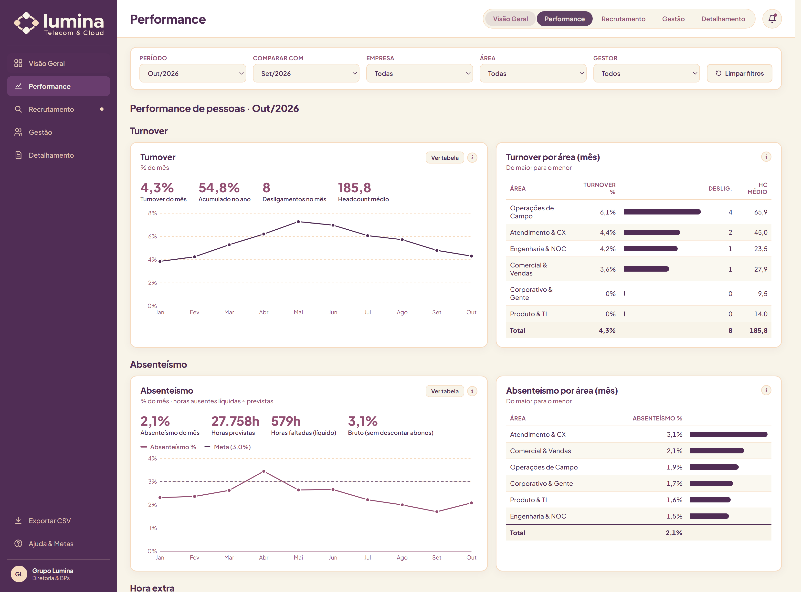
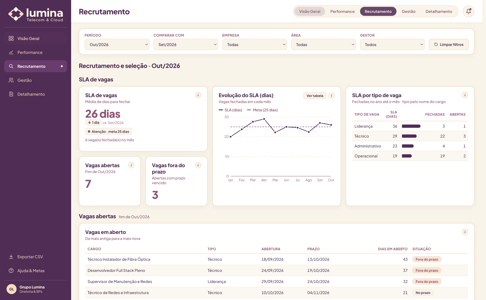
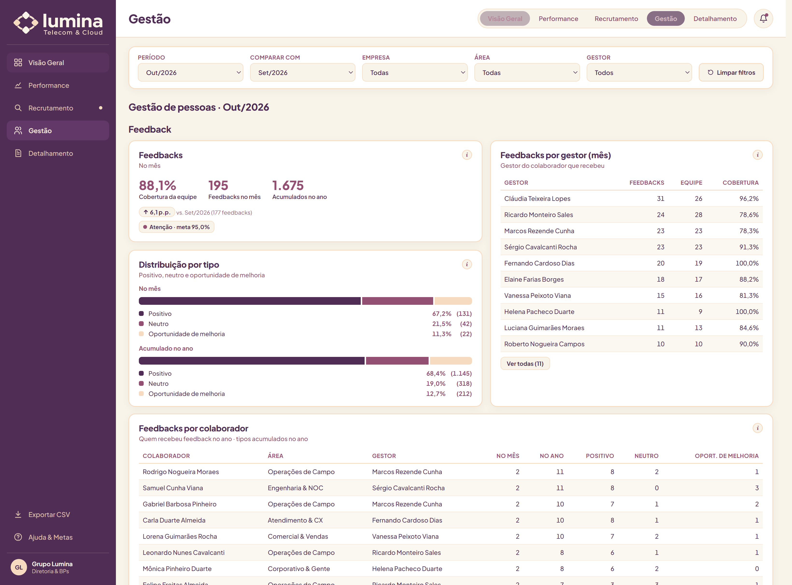
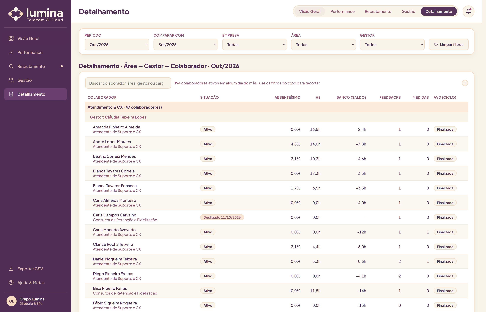
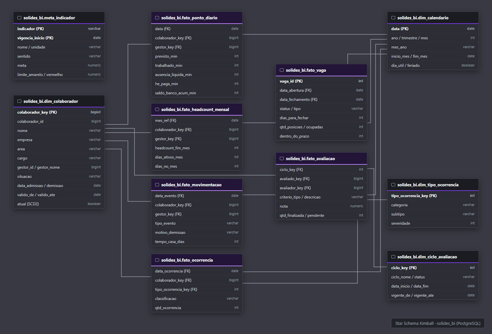

# People Analytics · Grupo Lumina Telecom & Cloud

    

Painel de People Analytics desenvolvido para o **Grupo Lumina (Telecom & Cloud)**, focado em centralizar indicadores de RH que antes ficavam espalhados entre planilhas e relatórios manuais de ponto.

O painel acompanha dados de jornada, banco de horas, absenteísmo, turnover, recrutamento e seleção (SLA de vagas), ocorrências disciplinares e ciclos de avaliação de desempenho (AVD). A base analisada consolida o fechamento de **outubro de 2026**, cobrindo 187 colaboradores ativos distribuídos em 3 empresas e 6 departamentos.

* **Painel Online (Netlify):** [case-rh-grupo-lumina.netlify.app](https://case-rh-grupo-lumina.netlify.app)
* **Apresentação Executiva (PDF):** [docs/Apresentacao_Executiva_Case_RH_Lumina.pdf](docs/Apresentacao_Executiva_Case_RH_Lumina.pdf)
* **Arquivo Power BI (.pbix):** [powerbi/Lumina RH Case.pbix](powerbi/Lumina%20RH%20Case.pbix)

## O problema que o projeto resolve

Antes do projeto, a equipe de RH precisava cruzar relatórios exportados do sistema de ponto com tabelas de recrutamento e planilhas de avaliação de desempenho para fechar os indicadores do mês. Esse processo gerava divergências de headcount e atrasava as tomadas de decisão da gerência.

Com a modelagem em banco de dados e o painel no Power BI, o fechamento mensal passou a ser automatizado, trazendo visões por área, empresa e colaborador com metas semafóricas (verde, amarelo e vermelho).

## Principais insights encontrados

* **Turnover sob controle:** A taxa de rotatividade fechou em 4,3% em outubro (8 desligamentos), dentro do limite estabelecido pela empresa de 5,0%.
* **Gargalo em Operações de Campo:** A área concentra a maior parte das horas extras da companhia (8,6% no geral, acima da meta de 8,0%) e gerou um saldo médio de +4,7h por pessoa no banco de horas.
* **Alerta no banco de horas:** Identifiquei 18 técnicos com mais de 40 horas acumuladas, o que requer alinhamento com a liderança para escalas de folga antes do fechamento do período semestral.
* **Tempo de contratação (SLA):** As vagas foram fechadas com média de 26 dias (meta de 25 dias). Vagas administrativas fecham em menos de 20 dias, enquanto posições de infraestrutura e engenharia demandam maior tempo de triagem.
* **Ciclo de Avaliação de Desempenho:** Aderência de 95,5% no ciclo 2026.2, restando 8 avaliações pendentes de validação pelos gestores.

## Telas do Painel

### 1. Visão Geral
Visão executiva com os indicadores principais do mês, quadro de headcount ativo e painel com alertas por área.

### 2. Performance e Jornada
Acompanhamento de faltas, horas extras, absenteísmo líquido e saldo acumulado de banco de horas por setor.

### 3. Recrutamento e Seleção
Volume de vagas abertas e fechadas no período, tempo médio de fechamento (SLA) e distribuição por cargo.

### 4. Gestão e Cultura
Aderência de feedbacks mensais, histórico de advertências ou suspensões e notas por critério da avaliação de desempenho.

### 5. Detalhamento por Colaborador
Tabela analítica com busca individual, permitindo ao gestor consultar o histórico de ponto, ocorrências e avaliações de cada membro do time.

## Como os dados foram organizados

Os dados brutos foram organizados no PostgreSQL em uma estrutura Star Schema (modelo estrela), facilitando a criação de cálculos no Power BI e melhorando o desempenho das consultas.

* **Tabelas Fato:**
  * `pbi_fato_ponto_diario`: horas trabalhadas, horas previstas, ausências e horas extras diárias.
  * `pbi_fato_headcount_mensal`: fotografia mensal de colaboradores ativos e equivalentes.
  * `pbi_fato_movimentacao`: admissões e demissões para cálculo de turnover.
  * `pbi_fato_vaga`: controle de abertura, fechamento e dias de SLA de contratação.
  * `pbi_fato_ocorrencia`: registros de feedbacks, elogios e medidas disciplinares.
  * `pbi_fato_avaliacao`: notas e status do ciclo de avaliação de desempenho.
* **Tabelas Dimensão:**
  * `pbi_dim_colaborador`: cadastro dos colaboradores com histórico de transferências de cargo e setor.
  * `pbi_dim_calendario`: tabela de datas de 2024 a 2027 com marcação de dias úteis e feriados nacionais.
  * `pbi_dim_tipo_ocorrencia` e `pbi_dim_ciclo_avaliacao`: categorias de apoio para filtros do relatório.
  * `pbi_meta_indicador`: tabela com os parâmetros de metas e faixas semafóricas.

## Validação dos Indicadores (SQL vs Power BI)

Para assegurar a confiabilidade dos números apresentados à diretoria, cruzei os resultados gerados pelas consultas SQL no banco com as medidas DAX calculadas no Power BI:

| Indicador (Out/2026) | Cálculo | SQL | Power BI | Meta |
|---|---|---:|---:|---|
| **Headcount Ativo** | Colaboradores ativos no último dia do mês | 187 | 187 | 187 |
| **Turnover no Mês** | Desligamentos / Headcount médio | 4,3% (8 desl.) | 4,3% (8 desl.) | Até 5,0% |
| **Absenteísmo Líquido** | Horas ausentes não abonadas / Horas previstas | 2,1% | 2,1% | Até 3,0% |
| **Hora Extra (% Jornada)** | Total de horas extras / Horas previstas | 8,6% | 8,6% | Até 8,0% |
| **Banco de Horas (Saldo)** | Saldo líquido / Colaboradores com ponto | +4,7h | +4,7h | Até ±4,0h |
| **SLA Médio de Contratação** | Média de dias corridos até o fechamento da vaga | 26 dias | 26 dias | Até 25 dias |
| **Cobertura de Feedbacks** | Colaboradores que receberam feedback no mês | 88,1% | 88,1% | Mínimo 95% |
| **Conclusão da Avaliação** | Avaliações finalizadas no ciclo 2026.2 | 95,5% | 95,5% | 100% |

## Tecnologias utilizadas

* **Banco de Dados:** PostgreSQL (criação de schemas, views analíticas e rotinas de carga).
* **Linguagens:** SQL para tratamento e transformação dos dados; DAX para cálculos de métricas e inteligência temporal no Power BI.
* **Visualização:** Power BI Desktop (versões `.pbix` e `.pbip` com modelo em TMDL).
* **Hospedagem Web:** Netlify para publicação da versão interativa online.

## Como visualizar ou executar o projeto

1. **Visualização direta (sem instalar nada):**
   * Acesse o link público: [case-rh-grupo-lumina.netlify.app](https://case-rh-grupo-lumina.netlify.app)
   * Ou consulte o relatório executivo em PDF: [docs/Apresentacao_Executiva_Case_RH_Lumina.pdf](docs/Apresentacao_Executiva_Case_RH_Lumina.pdf)

2. **Abrir o painel no Power BI:**
   * Baixe o arquivo [powerbi/Lumina RH Case.pbix](powerbi/Lumina%20RH%20Case.pbix) e abra diretamente no Power BI Desktop. Os dados já estão carregados na memória do modelo.

3. **Executar o banco de dados localmente (opcional):**
   * Crie uma base no PostgreSQL e execute os scripts da pasta `sql/` na seguinte ordem:
     1. `sql/01_schema_solides.sql` (estrutura inicial de tabelas)
     2. `sql/02_seed_solides_ficticio.sql` (inserção da massa de dados)
     3. `sql/03_solides_bi_views.sql` (criação do schema analítico e tabelas do modelo estrela)
